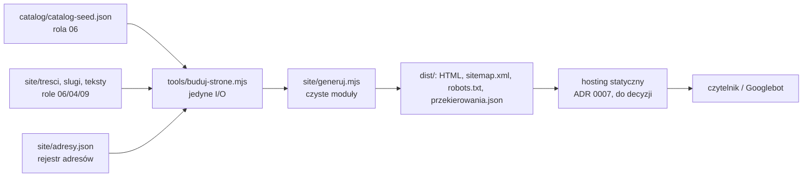

# Architektura strony JarAtlas.com

Stan: 2026-11-01, rola 05-architekt (build), E0–E4 zakończone. Szkielet kodu według wyjątku ADR 0006; przed scaleniem z `main` przegląd roli 07 w świeżym kontekście.

## 1. Cel i zakres
Statyczna strona z `catalog/catalog-seed.json`: karty wariantów, strony produktów i rodzin procesów w 35 językach (fala 1: 6). Bez kont, formularzy i danych użytkownika. Kontraktu zakresu roli 03 brak: zakres to przekazanie Słoika (`docs/jaratlas/00-PRZEKAZANIE.md` §6), jawne założenie z E0 (`E0-rozpoznanie-2026-11-01.md`). Świadomie poza zakresem: aplikacja JAR, wyszukiwarka, komentarze, reklamy i analityka (do decyzji).

## 2. Rejestr ograniczeń platformy
W raporcie E0 (`E0-rozpoznanie-2026-11-01.md`, wartości z cytatami, odczyt 2026-11-01): limit mapy strony Google, hreflang, kanoniczne, dane strukturalne Recipe. Limity hostingu: ADR 0007, do odczytu w dniu decyzji.

## 3. Kontekst

## 4. Moduły i granice
Zależności tylko do środka; `site/` zawiera wyłącznie czyste moduły (bez `node:*`), sprawdzane `npm run check:granice` (`docs/architektura/narzedzia/granice.mjs site .`, wynik 2026-11-01: `OK: 7 plików, bez naruszeń`).

| Moduł | Rola | Sygnatura (port) |
|---|---|---|
| `site/konfiguracja.mjs` | jedyne miejsce liczb i list (`konfiguracja.md`) | stałe |
| `site/plan.mjs` | bramka publikacji, slugi, hreflang | `wariantPublikowalny(v) → bool`; `sprawdzSlugi(slugi) → string[]`; `planStron(katalog, slugi, tresci) → { strony, bledy }` |
| `site/kontrole.mjs` | kontrole publikacji R2–R4 | `kontrolaZaslepek(strony, tresci, ui)`, `kontrolaOstrzezen(strony, katalog, tresci, ui) → string[]`; `kontrolaPrzekierowan(strony, adresy) → { bledy, przekierowania }` |
| `site/szablony.mjs`, `site/mapa.mjs` | HTML i `sitemap.xml` | czyste funkcje → tekst |
| `site/generuj.mjs` | składanie | `generuj({ katalog, slugi, tresci, ui, nazwyJezykow, adresy, dozwolZaslepki }) → { bledy, pliki, strony, przekierowania }` |
| `tools/buduj-strone.mjs` | adapter I/O (`npm run build`) | `node tools/buduj-strone.mjs [dane=site] [wyjście=dist] [katalog]` |
| `site/static/filtry.js` | filtr tabeli na fragmencie adresu | przeglądarka, bez zapisu |

Błędy domeny są wartościami (listy `bledy`), nie wyjątkami. Maszyna stanów publikacji wariantu: jedno przejście, `ukryta → opublikowana` (pole `publication` w katalogu, zmienia rola 06). Strona powstaje tylko przy `opublikowana` + bramce R1. Wycofanie to `retired: true` + wpis 301 w `adresy.json` (R4).

## 5. Dane
Danych użytkownika brak, więc `dane.md` i `schemat.sql` nie dotyczą (moduł `dane-lokalne-sqlite` nie dotyczy, E0 §6). Formaty plików wejściowych: `konfiguracja.md`, „Dane strony”. Katalog ma `version` (1.0.2), ale nie ma wersji formatu: zmiana struktury to ryzyko R9, łagodzone bramką zamkniętą domyślnie.

## 6. Polityka błędów buildu
| Rodzaj | Przykład | Zachowanie |
|---|---|---|
| Błąd kontroli treści lub adresów | brak ostrzeżenia, zaślepka, kolizja adresów, adres bez 301 | zebrane wszystkie, wypisane `BŁĄD …` na stderr, kod 1, `dist/` nietknięty |
| Błąd danych wejściowych | zły JSON, brak pliku katalogu | wyjątek Node, kod ≠ 0, `dist/` nietknięty (zapis dopiero po generowaniu) |
| Przerwanie w trakcie zapisu | brak miejsca, zabicie procesu | zapis do `dist.tmp`, podmiana na końcu; pozostały `dist.tmp` usuwa następny build |
| Brak treści w języku | slug bez treści | brak strony w tym języku (fale), nie błąd |

Zasada: wdrożenie bierze `dist/` tylko po kodzie 0 wszystkich kontroli (lista w `ryzyka.md`). Test: `tests/build.test.mjs`.

## 7. Budżety wydajności (pomiar bazowy; cele ustala właściciel)
Metoda: Lighthouse 12.8.2 (npm, poza zależnościami repo) z Chromium `/opt/pw-browsers/chromium-1243`, profil mobilny z symulowanym dławieniem (`formFactor: mobile`, `throttlingMethod: simulate`), serwer `python3 -m http.server`, 5 przebiegów na stronę, próbka `[PRZYKŁAD]` (12 wariantów, karta 8 sekcji × 3 akapity). Data: 2026-11-01.

| Scenariusz | Pomiar bazowy | Urządzenie | Dane | Miara | Metoda |
|---|---|---|---|---|---|
| LCP karty wariantu | 752 ms (maks. 765) | symulowany telefon Lighthouse | próbka, 7 739 B przesłane | mediana z 5 | Lighthouse jw. |
| LCP strony produktu | 807 ms (maks. 951) | jw. | 12 wierszy, 3 678 B | mediana z 5 | jw. |
| TBT / CLS | 0–5 ms / 0 | jw. | jw. | wszystkie przebiegi | jw. |
| Waga HTML karty | 7 030 B (gzip próbki niemiarodajny: powtarzany tekst) | — | próbka | bajty | `wc -c` |
| Prawdziwy telefon | brak | najstarszy wspierany telefon właściciela `[DO USTALENIA]` | pierwsze karty fali 1 | LCP p75 | Search Console, raport Core Web Vitals po publikacji (krok właściciela) |

Symulacja nie zastępuje pomiaru na urządzeniu; liczby to punkt odniesienia dla regresji. Znaleziska Lighthouse (dla 04 i 06): brak `favicon.ico` (błąd 404 w konsoli), strona produktu bez `meta description` (SEO 0,92), linki w tabeli wariantów za małe do dotyku (`target-size`, dostępność 0,95).

## 8. Prywatność i bezpieczeństwo
`prywatnosc.md`: 0 skryptów i zasobów stron trzecich, 0 cookies (test R5). Repo publiczne: brak sekretów; klucz API tłumaczeń tylko w sekretach środowiska.

## 9. Ryzyka, otwarte pytania, decyzje właściciela
Ścieżki ryzyka i lista kontroli dla 07: `ryzyka.md`. Decyzje czekające:
1. Hosting i domena (ADR 0007): potrzebny serwerowy 301 (R4).
2. Tekst uwagi D-027 (c): dziś `[DO USTALENIA]`, więc build pierwszej prawdziwej strony padnie na R2 (zamierzone).
3. Treść „ukryta” w publicznym repo (R1b): akceptacja z nazwą albo osobne prywatne repo treści.
4. CI na GitHub Actions (`ryzyka.md` pkt 5).
5. Reklamy i analityka; adres stron rodzin; obrazy do Recipe; wersja formatu katalogu (06).

## 10. Definicja ukończenia (build) z dowodami, 2026-11-01
| Punkt | Stan | Dowód |
|---|---|---|
| moduły wynikają z przepływu | tak | §4; przepływy E0 tabela „przepływ → technika” |
| ADR: data, status, ≥2 opcje, konsekwencje, Potwierdzenie | tak | `docs/adr/0001–0007` |
| rejestr ograniczeń z adresem, cytatem, datą | tak | E0, odczyt 2026-11-01 |
| SQLite: schemat, integrity_check, kaskada, UPSERT | nie dotyczy | brak bazy (§5) |
| ścieżki ryzyka z zabezpieczeniem i testem | tak, poza R1b i R4b (decyzje) | `ryzyka.md`; `npm test`: 43/43, kod 0; mutacje R1, R2, R4, R5, K1 wykryte |
| jedna lista parametrów z jednostkami i źródłem | tak | `konfiguracja.md`, test K1 |
| budżety z urządzeniem, danymi, miarą, metodą | pomiar bazowy; cele `[DO USTALENIA]` | §7 |
| inwentarz prywatności dla 10 | tak | `prywatnosc.md` |
| lista kontroli dla 07 | tak | `ryzyka.md`; `check:granice` 0, `check:catalog` 0, `check:tresci` 0, `npm run build` 0 |

## Indeks ADR
| ADR | Temat | Status |
|---|---|---|
| [0001](../adr/0001-generator-wlasny-node.md) | własny generator Node | przyjęta |
| [0002](../adr/0002-adresy-i-slugi.md) | adresy i slugi w języku odbiorcy | przyjęta |
| [0003](../adr/0003-bramka-publikacji-i-mapa-strony.md) | bramka publikacji i mapa strony | przyjęta |
| [0004](../adr/0004-hreflang-kanoniczne.md) | hreflang i kanoniczne | przyjęta |
| [0005](../adr/0005-karty-ostrzezenia-reklamy-filtry.md) | ostrzeżenia, reklamy, filtry | przyjęta |
| [0006](../adr/0006-wyjatek-roli-kod-szkieletu.md) | wyjątek: kod pisze 05 | przyjęta |
| [0007](../adr/0007-hosting-statyczny.md) | hosting | proponowana |
